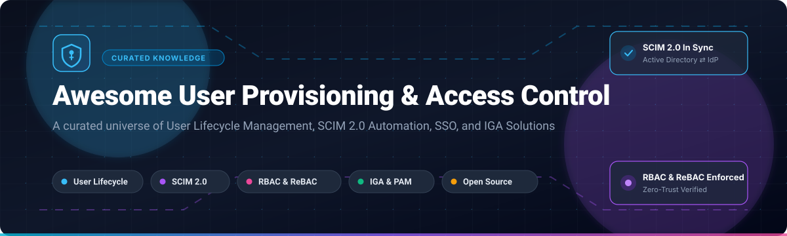

# Awesome User Provisioning & Permissions Management 🛡️🔑

  

  
  
  
  
  
  

> 🚀 A curated list of top **User Provisioning**, **Identity Lifecycle Management (ILM)**, **Directory Synchronization (SCIM 2.0)**, **Fine-Grained Permissions (RBAC/ABAC/ReBAC)**, and **Identity Governance and Administration (IGA)** platforms — comparing enterprise SaaS leaders and community-driven open-source alternatives.
> 
> ⭐ **Star this repo if you find it useful!** ⭐

---

## 📑 Table of Contents 🧭

- [🌐 Sector Overview & Market Dynamics](#-sector-overview--market-dynamics)
- [🟦 SaaS / Hosted Platforms](#-saas--hosted-platforms)
- [🟩 Open-Source Software](#-open-source-software)
- [📊 Feature Comparison at a Glance](#-feature-comparison-at-a-glance)
- [🤝 Contributing](#-contributing)
- [💖 Support & Sponsorship](#-support--sponsorship)
- [📈 Star History](#-star-history)
- [📄 License](#-license)

---

## 🌐 Sector Overview & Market Dynamics 📈

The global Identity and Access Management (IAM) and User Provisioning market is valued at approximately **$18 billion to $21 billion** (projected to reach over **$40 billion by 2030** at a compound annual growth rate of ~13–15%). 

The sector exhibits **moderate fragmentation with high concentration at the enterprise apex**: while mega-cap incumbents (Microsoft, Alphabet, Amazon) and dedicated pure-play leaders (Okta, CyberArk, Ping-ForgeRock) dominate core enterprise SSO, automated workforce provisioning, and PAM, the market experiences high dynamic fragmentation across fine-grained authorization (ReBAC, Zanzibar engines), AI/agentic security, and sovereignty-focused open-source frameworks.

---

## 🟦 SaaS / Hosted Platforms ☁️

Enterprise commercial user provisioning, workforce directory synchronization, and permissions management platforms sorted by company scale (market capitalization / enterprise valuation):

| Platform 🏢 | Company Scale / Valuation 💰 | Starting Tier Pricing 💳 | Free Tier / Trial Limits 🎁 | Primary Focus & Capabilities 🎯 |
|---|---|---|---|---|
| **Microsoft Entra ID** | **~$3.1 Trillion** (Microsoft Market Cap) | **$3.00/user/month** (Entra ID P1 standalone; included in M365 Business Premium / E3) | **Free forever plan** up to 50,000 active directory users (includes basic directory, cloud auth & self-service password reset; SCIM provisioning requires P1 or 30-day trial with 100 licenses) | Native Microsoft 365 identity, conditional access, Intune device compliance, and cloud SCIM provisioning. |
| **Google Cloud Identity / Workspace** | **~$2.1 Trillion** (Alphabet Market Cap) | **$6.00/user/month** (Cloud Identity Premium; Workspace starts at $6.00/user/month) | **Free forever plan** (Cloud Identity Free edition capped at 50 user licenses with core directory sync and standard 2SV) | Google-first identity layer, Google Workspace automated provisioning, SAML/OIDC SSO, and context-aware access. |
| **AWS IAM / IAM Identity Center** | **~$2.0 Trillion** (Amazon Market Cap) | **$0.00** (Pay-as-you-go infrastructure; IAM and Identity Center have $0 direct base platform fee) | **Free forever plan** with unlimited users and role assignments across AWS Organizations; charges apply solely for billable AWS resources consumed | Foundation access management, permission boundaries, ABAC tags, and centralized SCIM federation for AWS workloads. |
| **CyberArk Identity** | **~$12.5 Billion** (Market Cap) | **$2.00/user/month** (Single Sign-On starting tier; Adaptive MFA at $3.00/user/month) | **30-day free trial** with full enterprise features limited to 50 test users and 5 target applications | Privileged Access Management (PAM), credential vaulting, administrative session isolation, and high-risk provisioning. |
| **Okta Workforce Identity** | **~$11.8 Billion** (Market Cap) | **$2.00/user/month** (Single Sign-On basic tier; Lifecycle Provisioning add-on at $4.00/user/month) | **30-day free trial** with access to Okta Workforce Identity Cloud for up to 50 users and unlimited app integrations | Vendor-neutral enterprise IdP, extensive pre-built SCIM connectors, Okta Workflows, and adaptive MFA. |
| **Auth0 by Okta** | **Part of Okta** ($11.8B; acquired for ~$6.5B) | **$35.00/month** (B2C Essentials starting tier; B2B Team tier starts at $130.00/month) | **Free forever plan** limited to 7,500 monthly active users (MAUs), 3 external social identity providers, and unlimited logins | Developer-friendly authentication APIs, SDKs, Universal Login, Actions extensibility, and B2B user onboarding. |
| **Ping Identity (Ping/ForgeRock)** | **~$2.8 Billion** (Thoma Bravo PE valuation) | **$3.00/user/month** (PingOne for Workforce Essentials starting tier) | **30-day free trial** for PingOne Cloud platform limited to 100 test user identities | Complex hybrid enterprise federation (PingFederate, PingDirectory), legacy directory orchestration, and IGA. |
| **JumpCloud** | **~$2.6 Billion** (Valuation) | **$9.00/user/month** (Core Directory plan; Platform Plus tier at $15.00/user/month) | **Free forever plan** limited to 10 users and 10 devices with 10 days of premium chat support | Cross-platform cloud directory (Windows, macOS, Linux), built-in MDM, RADIUS, LDAP, and SCIM automated sync. |
| **OneLogin by One Identity** | **Part of Quest** (~$5.4B Quest Software valuation) | **$2.00/user/month** (SSO starting tier; Advanced Directory & Provisioning at $4.00/user/month) | **30-day free trial** granting unrestricted access to enterprise SSO, SmartFactor MFA, and SCIM directory sync | HR-driven provisioning (Workday, BambooHR to apps), SmartFactor MFA, and mid-market user lifecycle automation. |

---

## 🟩 Open-Source Software 💻

Community-driven, self-hosted user provisioning, identity management, and fine-grained authorization projects sorted by GitHub star count:

### 1. Keycloak 👑

- **Repository:** [keycloak/keycloak](https://github.com/keycloak/keycloak)
- **Stack & License:** Java | Apache-2.0
- **Overview:** The industry-standard open-source identity and access management system. Provides out-of-the-box OpenID Connect (OIDC) and SAML 2.0 Single Sign-On, LDAP and Active Directory user federation, identity brokering, dynamic client registration, and fine-grained authorization services. Widely adopted in enterprise architectures requiring on-premises or private-cloud identity brokering and SCIM synchronization.
- **Best For:** Battle-tested enterprise IAM foundation with widespread community support and robust protocol coverage.

### 2. Authelia 🛡️

- **Repository:** [authelia/authelia](https://github.com/authelia/authelia)
- **Stack & License:** Go | Apache-2.0
- **Overview:** An open-source authentication and authorization server providing two-factor authentication and single sign-on (SSO) for applications behind reverse proxies (Nginx, Traefik, Envoy, Caddy). Acts as an identity companion enforcing fine-grained URL-based access control policies, Duo/FIDO2 WebAuthn security keys, and LDAP/file user directory lookup.
- **Best For:** Homelab and cloud-native self-hosted architectures protecting internal dashboards and microservices.

### 3. Authentik ⚡

- **Repository:** [goauthentik/authentik](https://github.com/goauthentik/authentik)
- **Stack & License:** Python, Go | GPL-3.0
- **Overview:** An adaptable, modern open-source Identity Provider focused on flexibility and seamless integrations. Features built-in SCIM service provider (inbound) and SCIM synchronization (outbound) engine, OAuth2/OIDC, SAML, LDAP forward-proxy, and an intuitive pipeline flow builder for user enrollment, password recovery, and conditional access.
- **Best For:** Modern DevOps teams desiring native SCIM directory sync, user enrollment flows, and Kubernetes integration.

### 4. Casbin 🔐

- **Repository:** [casbin/casbin](https://github.com/casbin/casbin)
- **Stack & License:** Go (with multi-language SDKs in Java, Python, Node, Rust, C++) | Apache-2.0
- **Overview:** An authorization library that supports access control models like ACL, RBAC, and ABAC. Casbin separates access control policy definition from business logic via its classic PERM (Policy, Effect, Request, Matcher) metamodel, allowing dynamic user-role assignment and real-time permission enforcement across microservices.
- **Best For:** Embedding high-performance, policy-agnostic authorization directly within microservice backends.

### 5. Ory Kratos 🔑

- **Repository:** [ory/kratos](https://github.com/ory/kratos)
- **Stack & License:** Go | Apache-2.0
- **Overview:** A cloud-native, headless user management and identity system implementing IETF specifications. Implements clean APIs for user registration, multi-factor login, profile management, account verification, and account recovery without imposing opinionated HTML templates or UI frameworks.
- **Best For:** Headless, API-first identity architecture powering custom web and mobile user onboarding experiences.

### 6. OpenFGA 🌳

- **Repository:** [openfga/openfga](https://github.com/openfga/openfga)
- **Stack & License:** Go | Apache-2.0
- **Overview:** A CNCF incubating authorization engine modeled after Google's Zanzibar paper. OpenFGA delivers Relationship-Based Access Control (ReBAC) designed for hyperscale permissions queries, hierarchical inheritance, and cross-resource access checks with sub-millisecond evaluation latency.
- **Best For:** Multi-tenant SaaS applications requiring fine-grained, relationship-based permissions (ReBAC) like Google Drive-style sharing.

### 7. Ory Keto 🏛️

- **Repository:** [ory/keto](https://github.com/ory/keto)
- **Stack & License:** Go | Apache-2.0
- **Overview:** An open-source implementation of Google's Zanzibar cryptographic permissions system written in Go. Ory Keto stores relationship tuples and executes low-latency access-control checks across complex graph hierarchies, making it ideal for microservices authorization.
- **Best For:** Distributed cloud-native systems needing ultra-fast access checks across complex organizational hierarchies.

### 8. Cerbos 🎯

- **Repository:** [cerbos/cerbos](https://github.com/cerbos/cerbos)
- **Stack & License:** Go | Apache-2.0
- **Overview:** A stateless, context-aware authorization decision point that separates authorization policies from application source code. Policies are expressed in human-readable YAML/JSON with support for ABAC attributes, dynamic context, and dry-run testing suites.
- **Best For:** Decoupling business logic from authorization policies with lightweight, auditable sidecars.

### 9. Evolveum midPoint 🏛️

- **Repository:** [Evolveum/midpoint](https://github.com/Evolveum/midpoint)
- **Stack & License:** Java | Open Source (EUPL-1.2 / Subscription Model)
- **Overview:** The premier open-source Identity Governance and Administration (IGA) platform. Delivers automated provisioning and deprovisioning workflows, policy-based approvals, segregation of duties (SoD), access certification campaigns, role mining, and non-human identity lifecycle management across legacy and cloud connectors.
- **Best For:** Regulated enterprises, universities, and governments needing full IGA compliance without recurring seat licenses.

### 10. Apache Syncope 🔄

- **Repository:** [apache/syncope](https://github.com/apache/syncope)
- **Stack & License:** Java | Apache-2.0
- **Overview:** An enterprise-grade identity management solution by the Apache Software Foundation for identity provisioning, role management, access governance, and directory synchronization across heterogeneous systems. Offers connectors for LDAP, Active Directory, databases, OpenFGA, and SCIM 2.0 endpoints.
- **Best For:** Standards-based IGA workflows backed by the Apache Software Foundation governance model.

### 11. jelhub scimgateway 🌉

- **Repository:** [jelhub/scimgateway](https://github.com/jelhub/scimgateway)
- **Stack & License:** Node.js | MIT
- **Overview:** A specialized SCIM 2.0 gateway server that translates standardized SCIM provisioning requests from major IdPs (Okta, Entra ID, OneLogin) into legacy target API actions (REST, SOAP, SQL, LDAP, PowerShell, or custom scripts).
- **Best For:** Connecting cloud IdP auto-provisioning pipelines to legacy internal applications lacking native SCIM endpoints.

### 12. Nubus by Univention 🇪🇺

- **Repository:** [univention/Nubus](https://github.com/univention/Nubus)
- **Stack & License:** Python, TypeScript | AGPL-3.0
- **Overview:** A modular open-source identity and access management suite created for European digital sovereignty. Used by public administrations, ministries, and enterprise organizations (e.g., ZenDiS Sovereign Workplace) to orchestrate central identity directories, SSO portals, and user lifecycle events across hybrid infrastructures.
- **Best For:** European public sector and privacy-conscious enterprises prioritizing digital sovereignty.

### 13. arturoeanton GoSCIM 🚀

- **Repository:** [arturoeanton/goscim](https://github.com/arturoeanton/goscim)
- **Stack & License:** Go | MIT
- **Overview:** A lightweight, high-speed SCIM 2.0 server implementation in Go. Delivers complete RFC 7643 and RFC 7644 compliance, dynamic attribute parsing, filtering, and seamless Docker deployments with horizontal scalability.
- **Best For:** Microservices and custom internal tooling requiring a lightweight, standalone SCIM 2.0 endpoint.

### 14. Hanzo IAM 🤖

- **Repository:** [hanzoai/iam](https://github.com/hanzoai/iam)
- **Stack & License:** Go | Apache-2.0
- **Overview:** An AI-first IAM gateway and Model Context Protocol (MCP) authentication server with modern web console. Supports OAuth 2.1, OIDC, SAML, LDAP, WebAuthn, multi-tenancy, and SCIM provisioning for automated agentic and human user lifecycle management.
- **Best For:** Next-generation AI agents, MCP tooling authentication, and modern Go-centric architectures.

---

## 📊 Feature Comparison at a Glance 📋

| Solution 🧰 | License 📜 | Model ⚙️ | SCIM Provisioning 🔄 | Fine-Grained Permissions 🔐 | Self-Hosted 🏠 | Target Architecture 🎯 |
|---|---|---|---|---|---|---|
| **Microsoft Entra ID** | Proprietary | SaaS | ✅ Native SCIM 2.0 | ✅ RBAC & Conditional | ❌ | Microsoft 365 enterprises |
| **Google Workspace / Identity** | Proprietary | SaaS | ✅ Auto-provisioning | ✅ Role & Org Units | ❌ | Google Workspace organizations |
| **AWS IAM / Identity Center** | Proprietary | SaaS / Cloud | ✅ SCIM Inbound | ✅ ABAC & Policies | ❌ | AWS multi-account infrastructure |
| **CyberArk Identity** | Proprietary | SaaS | ✅ SCIM 2.0 | ✅ PAM & Least Privilege | ❌ | High-privilege administrative access |
| **Okta Workforce** | Proprietary | SaaS | ✅ Extensive SCIM | ✅ RBAC & Workflows | ❌ | Multi-vendor hybrid IT environments |
| **Auth0 by Okta** | Proprietary | SaaS | ✅ SCIM endpoints | ✅ RBAC & Actions | ❌ | Developer-facing web/mobile apps |
| **Ping Identity** | Proprietary | SaaS / Hybrid | ✅ Comprehensive | ✅ Federation & IGA | ❌ | Complex legacy & hybrid estates |
| **JumpCloud** | Proprietary | SaaS | ✅ SCIM & LDAP | ✅ RBAC & Device policies | ❌ | Small-to-mid enterprise directory |
| **OneLogin** | Proprietary | SaaS | ✅ HR-driven SCIM | ✅ SmartFactor & Roles | ❌ | Fast-growing mid-market SaaS |
| **Keycloak** | Apache-2.0 | Open Source | ✅ SCIM extensions | ✅ Dynamic RBAC/ABAC | ✅ | Enterprise self-hosted IAM |
| **Authelia** | Apache-2.0 | Open Source | 🔄 Via Reverse Proxy | ✅ Access Control Rules | ✅ | Reverse-proxy gateway security |
| **Authentik** | GPL-3.0 | Open Source | ✅ Native SCIM In/Out | ✅ Policy Execution Flows | ✅ | Modern cloud-native self-hosted IAM |
| **Casbin** | Apache-2.0 | Open Source | ➖ Library-level | ✅ ACL / RBAC / ABAC | ✅ | In-process microservice authorization |
| **Ory Kratos** | Apache-2.0 | Open Source | 🔄 API-driven | ➖ Focus on Identity | ✅ | Headless, custom UI user management |
| **OpenFGA** | Apache-2.0 | Open Source | ➖ Engine-level | ✅ ReBAC (Zanzibar model) | ✅ | Hyperscale relationship permissions |
| **Ory Keto** | Apache-2.0 | Open Source | ➖ Engine-level | ✅ ReBAC (Zanzibar model) | ✅ | Fast distributed graph authorization |
| **Cerbos** | Apache-2.0 | Open Source | ➖ Engine-level | ✅ ABAC / Stateless policies | ✅ | Policy-as-code sidecar microservices |
| **Evolveum midPoint** | EUPL-1.2 | Open Source | ✅ Deep Provisioning | ✅ Enterprise IGA & SoD | ✅ | Full identity governance & compliance |
| **Apache Syncope** | Apache-2.0 | Open Source | ✅ SCIM & Connectors | ✅ RBAC & IGA Workflows | ✅ | Open-source enterprise IGA |
| **jelhub scimgateway** | MIT | Open Source | ✅ SCIM Gateway Bridge | ➖ Translation layer | ✅ | Legacy systems without native SCIM |
| **Nubus** | AGPL-3.0 | Open Source | ✅ Lifecycle sync | ✅ Centralized roles | ✅ | European public sector sovereignty |
| **GoSCIM** | MIT | Open Source | ✅ Dedicated SCIM 2.0 | ➖ SCIM attributes | ✅ | Lightweight SCIM server |
| **Hanzo IAM** | Apache-2.0 | Open Source | ✅ SCIM support | ✅ RBAC & Multi-tenant | ✅ | AI agents and MCP gateways |

---

## 🤝 Contributing 💡

Contributions are warmly welcomed! If you have experience with a user provisioning framework, directory sync component, or permissions engine that belongs here:

1. 🍴 Fork the repository.
2. 🌿 Create a feature branch (`git checkout -b feature/new-iam-tool`).
3. 📝 Add your entry with stack details, license, and why it stands out.
4. ⭐ Ensure open-source projects are actively maintained (commit activity within the last 12 months).
5. 🚀 Open a Pull Request!

Check out our curated ecosystem lists on [Awesome-Awesome-Awesome](https://github.com/ishandutta2007/Awesome-Awesome-Awesome) for more curated tech stacks.

---

## 💖 Support & Sponsorship ☕

If this repository has helped simplify your user provisioning pipeline, saved engineering hours, or aided in selecting the right permissions engine, please consider supporting the project:

- ⭐ **Star this repository** to improve discoverability on GitHub!
- 🍴 **Fork and share** with colleagues, DevOps teams, and security engineers.
- ☕ **Buy a coffee & sponsor** ongoing maintenance via the [GitHub Sponsors Dashboard](https://github.com/sponsors/ishandutta2007).

Your support enables continuous updates, new tooling benchmarks, and ecosystem maintenance! 🙌

---

## 📈 Star History 📊

---

## 📄 License ⚖️

This curated compilation is released under [CC0 1.0 Universal (Public Domain)](https://creativecommons.org/publicdomain/zero/1.0/). Listed software platforms and tools remain copyrighted by their respective owners and subject to their individual licensing terms.
